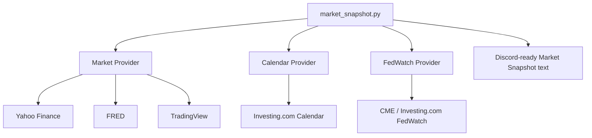

# Market Snapshot v1.2

## 概要

Market Snapshot v1.2 は、v1.1 の Market / FRED / TradingView に加えて、経済指標カレンダーと FedWatch を表示する拡張です。

既存の Discord 投稿形式と既存APIは維持し、各Providerの取得失敗がBot全体を停止させない方針を継続します。

## 構成図



## 取得元

| Provider | ファイル | 取得元 | 失敗時 |
| --- | --- | --- | --- |
| Yahoo Finance | `market_data.py` | Yahoo Finance | 各シンボルを `None` |
| FRED | `fred_data.py` | FRED API | APIキー未設定または失敗時は `None` |
| TradingView | `tradingview_data.py` | tradingview_ta | 各シンボルを `None` |
| Economic Calendar | `economic_calendar.py` | Investing.com Calendar | 空配列 `[]` |
| FedWatch | `fedwatch.py` | CME / Investing.com FedWatch | `None` |

本物のAPIキーやWebhook URLは、この設計書には記載しません。

## Economic Calendar

`economic_calendar.py` は当日の経済イベントを取得し、以下の形に正規化します。

- `datetime`
- `country`
- `event`
- `importance`
- `forecast`
- `previous`
- `actual`

戻り値は `list[EconomicEvent]` です。取得失敗、レスポンス形式不一致、通信エラー時は空配列を返します。

外部取得元が403やtimeoutになる可能性があるため、現行実装では optional Provider です。既定では `ENABLE_ECONOMIC_CALENDAR=false` とし、有効化された場合だけ取得を試みます。

Market Snapshot では `📅 Today's Events` として最大数件を表示します。

例:

```text
📅 Today's Events
🇺🇸 CPI ★★★
21:30

🇺🇸 FOMC Minutes ★★
```

## FedWatch

`fedwatch.py` はFedWatch相当の金利確率を取得し、以下の形に正規化します。

- `next_meeting`
- `hold_probability`
- `cut_probability`
- `hike_probability`
- `updated_at`

戻り値は `FedWatchSnapshot | None` です。取得失敗、パース失敗、形式不一致時は `None` を返します。

CME / Investing.com は403やtimeoutになる可能性があるため、現行実装では optional Provider です。既定では `ENABLE_FEDWATCH=false` とし、有効化された場合だけ取得を試みます。

Market Snapshot では `🏦 FedWatch` として表示します。

例:

```text
🏦 FedWatch
Next meeting: 2026-07-29

Hold
78%

Cut
22%

Hike
0%
```

## Provider分離

`market_snapshot.py` は以下を独立Providerとして扱います。

- Market Provider
  - Yahoo Finance
  - FRED
  - TradingView
- Calendar Provider
  - Economic Calendar
- FedWatch Provider
  - FedWatch

Providerは `fetch_snapshot_sources()` に注入できるため、pytestではAPIアクセスなしで検証できます。

## エラー方針

- 1つのProviderが失敗してもBot全体は停止しません。
- 取得失敗時はログに警告を残し、該当セクションを unavailable として表示します。
- FRED APIキー未設定時もBotは継続します。

## テスト方針

pytestでは以下をAPIモックで検証します。

- Economic Calendar 正常系
- Economic Calendar 異常系
- FedWatch 正常系
- FedWatch 異常系
- Market SnapshotへのCalendar/FedWatch表示
- Provider単位の部分失敗継続

## 今後追加候補

- Fear & Greed
  - CNN Fear & Greedなどを候補に、市場センチメントの補助指標として追加する案。
- AI Risk Score
  - Market Snapshot、news-feed-bot、将来のmarket_stateを入力にして、AIで統合リスクスコアを出す案。
- Polymarket
  - 選挙、政策、地政学イベントなどの確率市場を補助情報として利用する案。
- COT Report
  - IMMポジションや投機筋ポジションから、為替・金利・コモディティの需給偏りを見る案。
